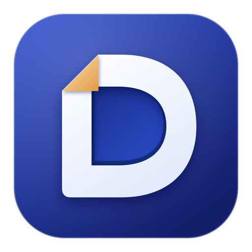

# DraftWord — downloads

*[Versão em português](README.md)*

DraftWord is a word processor for macOS and Windows, made as a hobby.
**It is free and accepts no payment of any kind**: no sales, subscriptions, ads or donations.
It is not a commercial offering and is not in any app store.

Based on [WordCraft](https://github.com/storytold/wordcraft) (MIT OR Apache-2.0), with its own
interface, icons and themes. License notices and attributions ship inside each package.

## Downloads

| System | File | Notes |
|---|---|---|
| macOS 11+ (Intel and Apple Silicon) | [`macOS/`](macOS/) — universal `.dmg` | Signed with a Developer ID and notarized by Apple: opens without warnings. Drag DraftWord to Applications. |
| Windows 10/11 (x64) | [`windows/`](windows/) — `.exe` or portable `.zip` | No code-signing certificate: on first launch SmartScreen may warn; choose "More info › Run anyway". |

Each file has a `.sha256` next to it for verification.

## How to install

### macOS

1. Open the [`macOS/`](macOS/) folder, click the `.dmg` file, then the **Download** button.
2. Open the downloaded file. A window shows the DraftWord icon next to the Applications folder.
3. Drag DraftWord onto Applications.
4. Launch DraftWord from Launchpad or the Applications folder. There is no warning: the app is notarized by Apple.
5. You can eject the "DraftWord" disk and delete the `.dmg`.

### Windows

1. Open the [`windows/`](windows/) folder, click the `.exe` file, then the **Download** button.
2. If nothing shows up, check the browser's download list: Edge may hold the `.exe` because it has no paid certificate. Click the three dots next to the file and choose **Keep**. Chrome usually lets it through.
3. Double-click the downloaded file.
4. If the blue "Windows protected your PC" screen appears, click **More info**, then **Run anyway**. The button only shows after "More info". That is SmartScreen noting the app has no paid certificate; it happens on the first run only.
5. Follow the installer: accept the license, pick the folder, Install, Finish. It installs for your user only and does not ask for an administrator password.
6. DraftWord is in the Start menu.

**Not allowed to install programs?** Download the portable `.zip`, unzip it into a folder of yours (Documents, for example) and open the `DraftWord.exe` inside. Nothing is installed.

### Updating

Download the new version's file and install it over the old one. Your documents stay where you saved them; the installation does not touch them.

## Current version

0.6.1-draftword.21 (October 17, 2026).

What's new: the interface no longer mentions Microsoft brands where a neutral term exists: "Word Document" became "DOCX Document", SmartArt became "Diagram" (with the "Diagram Design" tab), WordArt became "text art" and "Office 2003 default" became "Classic default (2003)"; error messages follow the same rule. From .20: the Windows installer is an `.exe`, which Edge accepts more readily than the `.msi` and installs without an administrator password. From .19: a Close button on the app's first row that closes the document and returns to the Library without closing the window; a second row in the bullet library (● ■ □ ❖ ► ★ →); Wingdings bullets from Word files no longer show as a boxed "?". From .18: new icon, Options on the File screen, Windows background, zoom slider and one page at a time, Full Mode button.

## Source code

DraftWord's source lives in a private repository. This repository holds only the installers.
