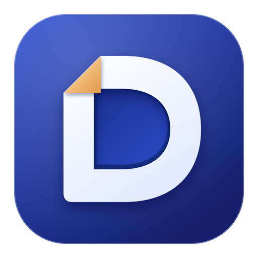

# DraftWord — downloads

*[Versão em português](README.md)*

DraftWord is a word processor for macOS and Windows, made as a hobby.
**It is free and accepts no payment of any kind**: no sales, subscriptions, ads or donations.
It is not a commercial offering and is not in any app store.

Based on [WordCraft](https://github.com/storytold/wordcraft) (MIT OR Apache-2.0), with its own
interface, icons and themes. License notices and attributions ship inside each package.

## Downloads

| System | File | Notes |
|---|---|---|
| macOS 11+ (Intel and Apple Silicon) | [Download the universal DMG](https://github.com/alexanderlobo-spec/DraftWord-releases/releases/download/v0.6.1-draftword.24/DraftWord-0.6.1-draftword.24-macOS-universal-2026-11-27.dmg) | [Release notes and SHA-256](https://github.com/alexanderlobo-spec/DraftWord-releases/releases/tag/v0.6.1-draftword.24) |
| Windows 10/11 (x64) | [`windows/`](windows/) — `.exe` or portable `.zip` | No code-signing certificate: on first launch SmartScreen may warn; choose "More info › Run anyway". |

Each file has a `.sha256` next to it for verification.

## How to install

### macOS

1. [Download DraftWord for macOS](https://github.com/alexanderlobo-spec/DraftWord-releases/releases/download/v0.6.1-draftword.24/DraftWord-0.6.1-draftword.24-macOS-universal-2026-11-27.dmg).
2. Open the downloaded file. A window shows the DraftWord icon next to the Applications folder.
3. Drag DraftWord onto Applications.
4. Launch DraftWord from Launchpad or the Applications folder. There is no warning: the app is notarized by Apple.
5. You can eject the "DraftWord" disk and delete the `.dmg`.

### Windows

1. Open the [`windows/`](windows/) folder, click the `.exe` file, then the **Download** button.
2. If nothing shows up, check the browser's download list: Edge may hold the `.exe` because it has no paid certificate. Click the three dots next to the file and choose **Keep**. Chrome usually lets it through.
3. Double-click the downloaded file.
4. If the blue "Windows protected your PC" screen appears, click **More info**, then **Run anyway**. The button only shows after "More info". That is SmartScreen noting the app has no paid certificate; it happens on the first run only.
5. Follow the installer: accept the license, pick the folder, Install, Finish. It installs for your user only and does not ask for an administrator password.
6. DraftWord is in the Start menu.

**Not allowed to install programs?** Download the portable `.zip`, unzip it into a folder of yours (Documents, for example) and open the `DraftWord.exe` inside. Nothing is installed.

### Updating

Download the new version's file and install it over the old one. Your documents stay where you saved them; the installation does not touch them.

## Current macOS version

[0.6.1-draftword.24](https://github.com/alexanderlobo-spec/DraftWord-releases/releases/tag/v0.6.1-draftword.24) (November 27, 2026).

The selected language is preserved when windows close in a different order. When closing a formatted plain-text document, you can save it as DOCX to keep its font, color and alignment.

## Source code

DraftWord's source lives in a private repository. This repository holds only the installers.
