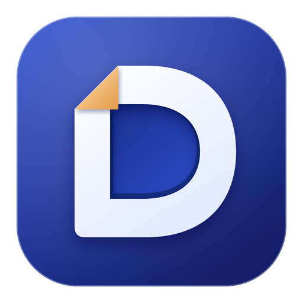

# DraftWord — downloads

*[English version](README.en.md)*

DraftWord é um processador de texto para macOS e Windows, feito como hobby.
**É gratuito e não aceita pagamento de nenhum tipo**: sem venda, assinatura, anúncios ou doações.
Não é uma oferta comercial e não está em nenhuma loja.

Baseado no [WordCraft](https://github.com/storytold/wordcraft) (MIT OR Apache-2.0), com interface,
ícones e temas próprios. Os avisos de licença e as atribuições vão dentro de cada pacote.

## Downloads

| Sistema | Arquivo | Observações |
|---|---|---|
| macOS 11+ (Intel e Apple Silicon) | [Baixar o DMG universal](https://github.com/alexanderlobo-spec/DraftWord-releases/releases/download/v0.6.1-draftword.24/DraftWord-0.6.1-draftword.24-macOS-universal-2026-11-27.dmg) | [Notas da versão e SHA-256](https://github.com/alexanderlobo-spec/DraftWord-releases/releases/tag/v0.6.1-draftword.24) |
| Windows 10/11 (x64) | [`windows/`](windows/) — `.exe` ou `.zip` portátil | Sem certificado de assinatura: na primeira abertura o SmartScreen pode avisar; escolha "Mais informações › Executar assim mesmo". |

Cada arquivo tem um `.sha256` ao lado para conferência.

## Como instalar

### macOS

1. [Baixe o DraftWord para macOS](https://github.com/alexanderlobo-spec/DraftWord-releases/releases/download/v0.6.1-draftword.24/DraftWord-0.6.1-draftword.24-macOS-universal-2026-11-27.dmg).
2. Abra o arquivo baixado. Aparece uma janela com o ícone do DraftWord e a pasta Aplicativos.
3. Arraste o DraftWord para Aplicativos.
4. Abra o DraftWord pelo Launchpad ou pela pasta Aplicativos. Não há aviso: o app é notarizado pela Apple.
5. Pode ejetar o disco "DraftWord" e apagar o `.dmg`.

### Windows

1. Entre na pasta [`windows/`](windows/), clique no arquivo `.exe` e depois no botão **Download**.
2. Se o download não aparecer, olhe a lista de downloads do navegador: o Edge pode segurar o `.exe` por não ter certificado pago. Clique nos três pontos ao lado do arquivo e escolha **Manter**. No Chrome o download costuma passar direto.
3. Dê dois cliques no arquivo baixado.
4. Se aparecer a tela azul "O Windows protegeu o computador", clique em **Mais informações** e depois em **Executar assim mesmo**. O botão só aparece depois de "Mais informações". É o SmartScreen avisando que o app não tem certificado pago; acontece só na primeira vez.
5. Siga o instalador: aceitar a licença, escolher a pasta, Instalar, Concluir. Ele instala só para o seu usuário e não pede senha de administrador.
6. O DraftWord fica no menu Iniciar.

**Sem permissão para instalar programas?** Baixe o `.zip` portátil, descompacte numa pasta sua (Documentos, por exemplo) e abra o `DraftWord.exe` de dentro dela. Nada é instalado.

### Atualizar

Baixe o arquivo da versão nova e instale por cima. Os documentos ficam onde você salvou; a instalação não mexe neles.

## Versão atual para macOS

[0.6.1-draftword.24](https://github.com/alexanderlobo-spec/DraftWord-releases/releases/tag/v0.6.1-draftword.24) (27/nov/2026).

O idioma escolhido é preservado ao fechar janelas em outra ordem. Ao fechar um documento de texto simples com formatação, você pode salvá-lo em DOCX e manter fonte, cor e alinhamento.

## Código-fonte

O código do DraftWord fica em um repositório privado. Este repositório guarda só os instaladores.
